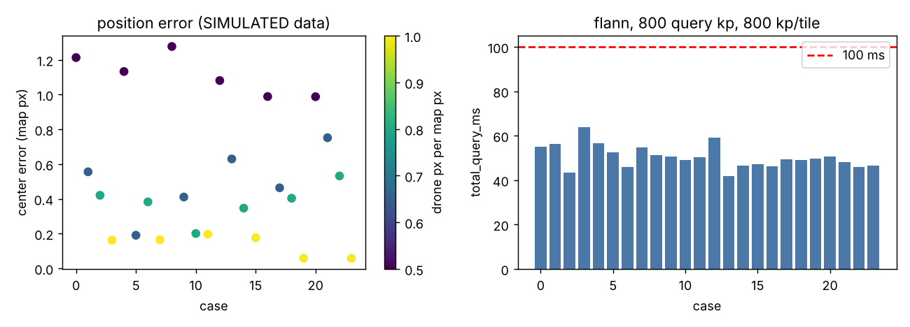

# Drone-visual-localization

Locate a small drone image inside a large map using feature matching and a homography.
Python and C++ (OpenCV). An offline map index makes each query fast. Tested on simulated
data with measured pixel error and timings.

```
OFFLINE (once per map)                       ONLINE (per drone image)
map -> tiled ORB -> index (xy + descriptors)  drone -> ORB -> match against index -> RANSAC homography -> center + footprint
```

| Command | What it does |
|---|---|
| `localize.py build-index` | detect ORB keypoints on the whole map (1024 px tiles, 128 px overlap), save `index.npz` |
| `localize.py query` | detect on the drone image only, match against the index (BF or FLANN-LSH), RANSAC homography |
| `localize.py match` | direct pair matching, `--method orb` or `--method superglue`, with drone-scale search |
| `cpp/localize.cpp` | C++ port of `build-index` and `query`, same log fields |

## Quick start (no private images needed)

`demo/` holds a synthetic 2048x1152 map and a 400x250 crop (scale 0.8, 5 deg rotation,
brightness change). Ground truth centre: (1210, 640).

```bash
pip install -r requirements.txt
python localize.py build-index --map demo/map.png --out demo/index.npz --export-idx demo/index.idx
python localize.py query --index demo/index.npz --drone demo/drone.png --map demo/map.png \
    --out results/demo --matcher flann --features 800 --repeat 5
```

Measured on the demo (flann, 800 query keypoints): centre (1210.15, 640.13), error 0.20 px,
`total_query_ms` 9.7. BF gives error 0.15 px. Output: `results/demo/log.json`, `results/demo/overlay.png`.

C++ (OpenCV 4 development files required):

```bash
cmake -S cpp -B cpp/build && cmake --build cpp/build
./cpp/build/localize query --index demo/index.idx --drone demo/drone.png --out results/demo \
    --matcher flann --features 800 --repeat 5
```

C++ reads the `.idx` written by `--export-idx` (or builds its own with `localize build-index`).
On the demo, Python and C++ locations differ by 0.000 px for both matchers, with a Python-built
or a C++-built index. Inlier counts differ (BF: 98 Python, 85 C++) because RANSAC sampling
differs between OpenCV 5.0.0 (Python) and 4.6.0 (C++).

## Results (SIMULATED data, measured on my sandbox CPU)

Setup: synthetic 7680x4320 map, 24 crops of 800x500 px at random positions, drone scale 0.5 to 1.0
(drone px per map px), rotation within +/-10 deg, brightness change (gain 0.8 to 1.2, offset +/-20),
index 800 keypoints per tile (23,938 keypoints). 2 CPU cores, OpenCV 5.0.0 (Python).
"success" = footprint convex, at least 8 inliers, centre within 5 px of ground truth.
`total_query_ms` = detect + match + homography on the drone image; it excludes image decoding and
the one-time index load. Medians over 24 cases (each case timed 3 times, median taken).

| Matcher | Query kp | Success | Mean err (px) | Max err (px) | Median total_query_ms | Worst case (ms) | Cases under 100 ms |
|---|---|---|---|---|---|---|---|
| BF | 800 | 24/24 | 0.53 | 1.23 | 96.8 | 116.3 | 58.3 % |
| BF | 1500 | 24/24 | 0.54 | 1.32 | 190.2 | 262.8 | 0 % |
| FLANN-LSH | 800 | 24/24 | 0.53 | 1.28 | 49.5 | 64.0 | 100 % |
| FLANN-LSH | 1500 | 24/24 | 0.55 | 1.28 | 86.6 | 128.5 | 75.0 % |

Timings vary from run to run on this shared machine. Repeating the same configuration:
FLANN-LSH 800 kp gave median 49.5 to 59.2 ms over 4 runs (worst single case 92.1 ms);
FLANN-LSH 1500 kp gave median 72.6 to 100.2 ms over 5 runs. Only FLANN-LSH with 800 query
keypoints was under 100 ms for every case in every run.



Index (7680x4320 map): build 1.35 to 1.68 s (3 Python builds), file 0.96 MB, load 2.6 to 7.1 ms (BF)
or 12.6 to 14.9 ms (FLANN, includes LSH training). Per-case numbers: `results/sim_main_cases.csv`.

### Drone scale

The drone image and the map must be compared at the same scale. In `match` mode the map is
downscaled by `s_map`, so the drone image is resized by `rel * s_map`, where `rel` is the map
pixels per drone pixel at full resolution:

- `--drone-scale-rel R` uses a known `R`.
- Otherwise a set of candidates is tried (`--scale-candidates`, default 0.25 0.35 0.5 0.7 1.0 1.4 2.0)
  and the scale with the most RANSAC inliers is kept. The chosen value is written to `log.json`
  as `drone_scale_rel_chosen`. Scales that shrink the drone below 32 px are skipped.

Measured on one simulated pair (800x500 crop at (3000, 1500), same scale as the map, 7680x4320 map):

| `match` run (ORB) | Success | Inliers | Error (px) | Match time (ms) |
|---|---|---|---|---|
| map 1500 px, drone left at full size (old behaviour) | no | 0 | - | 163.7 |
| map 1500 px, `--drone-scale-rel 1.0` | yes | 31 | 0.64 | 89.1 |
| map 1500 px, scale search (6 scales run) | yes | 31 | 0.64 | 552.2 |
| map 3840 px, scale search (7 scales run) | yes | 118 | 0.14 | 2394.7 |
| full-resolution map, `--drone-scale-rel 1.0` | yes | 179 | 0.23 | 854.0 |

In `query` mode the map is not downscaled, so the default is scale 1.0 and ORB's own pyramid covers
the 0.5 to 1.0 range tested above. `--drone-scale-rel` and `--scale-search` are available. On the
24 cases, with FLANN-LSH and 1500 query keypoints: no scale handling gave mean 0.55 px, median
94.9 ms; the true scale given (an oracle, not available in practice) gave mean 0.40 px, median 117.8 ms;
scale search gave mean 0.39 px, median 490.4 ms. All 24/24 succeeded in each mode.

## Run on your own images

```bash
python localize.py build-index --map data/full_image.jpg --out data/index.npz --export-idx data/index.idx
python localize.py query --index data/index.npz --drone data/crop_drone.jpg --map data/full_image.jpg \
    --out results/real --matcher flann --features 800 --repeat 5
python localize.py match --drone data/crop_drone.jpg --map data/full_image.jpg --out results/real_match \
    --method orb --map-max-side 3840
# SuperGlue (needs torch and a clone of magicleap/SuperGluePretrainedNetwork)
python localize.py match --drone data/crop_drone.jpg --map data/full_image.jpg --out results/real_sg \
    --method superglue --superglue-path ../SuperGluePretrainedNetwork --map-max-side 2000 \
    --max-keypoints 512 --sinkhorn-iters 10
```

`data/` is git-ignored. `log.json` holds the matches, inliers, `success`, the centre in full-resolution
map pixels, and the timings (`index_build_ms`, `index_load_ms`, `query_detect_ms`, `query_match_ms`,
`homography_ms`, `total_query_ms`, plus `total_query_under_100ms`).

### Results on real images

| Method | Device | Matches | Inliers | total_query_ms |
|---|---|---|---|---|
| ORB index + FLANN-LSH | CPU | TBD | TBD | TBD |
| ORB index + BF | CPU | TBD | TBD | TBD |
| SuperPoint + SuperGlue | CPU | TBD | TBD | TBD |

TBD until measured on the real map and crop. The simulated numbers above do not carry over to
real imagery.

## Tests

```bash
python tests/run_simulation.py --work sim_work --out results --cases 24 --repeat 3 \
    --features 800 1500 --per-tile 800 --matchers bf flann --modes none --tag sim_main
python tests/run_simulation.py --work sim_work --out results --cases 24 --repeat 1 \
    --features 1500 --per-tile 800 --matchers flann --modes none known search --tag sim_scale
python tests/plot_results.py --csv results/sim_main_cases.csv --out results/sim_error_time.png \
    --matcher flann --features 800 --per-tile 800
python tests/make_demo.py      # regenerates demo/
```

`tests/simlib.py` builds the synthetic map and the crops with known ground truth.

## Notes and limitations

- All measured numbers come from synthetic data on a 2-core sandbox CPU. The SuperGlue path
  is not covered by the tests (it needs torch and the external repository).
- ORB features are not robust to large changes in season, lighting or viewpoint. The map index
  holds full-resolution keypoints, so a 33 MP map needs no downscaling at query time.
- A single homography assumes a roughly planar scene.
- I reviewed [TESSERA](https://github.com/ucam-eo/tessera). It targets Sentinel-1/2 time series, so
  it is not used in this pipeline.

## License

MIT, see `LICENSE`. SuperPoint/SuperGlue has its own non-commercial research license and is not
included in this repository.
